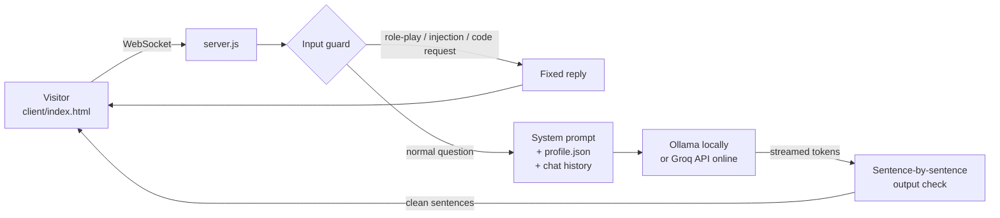

# AI Guide – Personal AI Chat for Recruiters

An AI chat that answers recruiters' questions about my professional background: experience, education, projects and goals. It runs on my portfolio website and streams answers live from a language model: locally with Ollama, online through the Groq API.

## Features

- **Live streaming answers** over WebSockets
- **Only approved facts:** everything the bot knows comes from [`server/bot/profile.json`](server/bot/profile.json)
- **English and German**, with formal "Sie" and Swiss spelling in German
- **Three layers of protection** against made-up answers and misuse:
  1. **Input guard:** role-play, prompt-injection and code requests get a fixed reply and never reach the model
  2. **System prompt:** strict rules plus example answers the model follows
  3. **Output check:** every answer is checked sentence by sentence before the visitor sees it (speculation, recommending other candidates and internal names are removed)
- **Reference contact** is added automatically to questions about my work experience

## How it works



- The **profile is re-read on every request**, so facts can be updated without restarting the server.
- The **chat history** sent by the browser is validated and capped (20 messages, length limit) before it reaches the model.
- **Low temperature (0.1)** and a larger context window (8,192 tokens) keep answers consistent and stop the rules from being cut off in long chats.
- If the model fails to add the reference contact, the server **appends it automatically** for questions about work experience.
- Online, the server only accepts the portfolio website as origin and limits each visitor to 30 questions per hour, which protects the free API quota.

## Tech stack

Node.js · WebSockets (`ws`) · Ollama (llama3.2, locally) · Groq API (gpt-oss, online) · HTML / CSS / JavaScript

## Project structure

```
server/
  server.js          WebSocket server (ws://localhost:8080/ws)
  bot/OllamaBot.js   Prompt, input guard, streaming and output check
  bot/profile.json   Approved facts about me
client/
  index.html         Standalone chat page
```

## Run it locally

Requirements: [Node.js](https://nodejs.org) and [Ollama](https://ollama.com) with the model installed (`ollama pull llama3.2`).

```bash
cd server
npm install
npm start
```

Then open `client/index.html` in the browser.

Another model can be used with the environment variable `OLLAMA_MODEL`, for example `OLLAMA_MODEL=qwen2.5:7b`.

## Hosting

Online, the bot uses a hosted language model instead of Ollama. Any OpenAI-compatible API works; Groq is the default.

| Variable | Purpose |
|---|---|
| `LLM_API_KEY` | API key; when set, the hosted model replaces Ollama |
| `LLM_API_URL` | API address (default `https://api.groq.com/openai/v1`) |
| `LLM_MODEL` | Models in order, comma-separated; the next one is used when a rate limit is reached (default `openai/gpt-oss-120b,openai/gpt-oss-20b`) |
| `LLM_REASONING_EFFORT` | Thinking effort for gpt-oss models: `low`, `medium` (default) or `high` |
| `REFERENCE_NAME`, `REFERENCE_PHONE`, `REFERENCE_EMAIL` | Reference contact the bot shares; fills the `$REFERENCE_…` values in `profile.json` |
| `DISCORD_WEBHOOK_URL` | Contact form of the portfolio: `POST /contact` forwards messages to this Discord webhook |
| `ALLOWED_ORIGINS` | Websites allowed to use the chat and contact form, comma-separated |
| `MAX_QUESTIONS_PER_HOUR` | Questions per visitor and hour (default 30) |

Locally the variables can go in `server/.env` (see [`server/.env.example`](server/.env.example)). [`render.yaml`](render.yaml) sets up the server on [Render](https://render.com); the server answers `GET /health` for health checks and uptime monitors.

> **Note:** Private contact details are not stored in this repository. Values like `"$REFERENCE_PHONE"` in `profile.json` come from environment variables, and a contact without values is left out.
